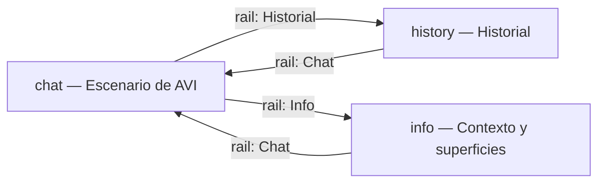
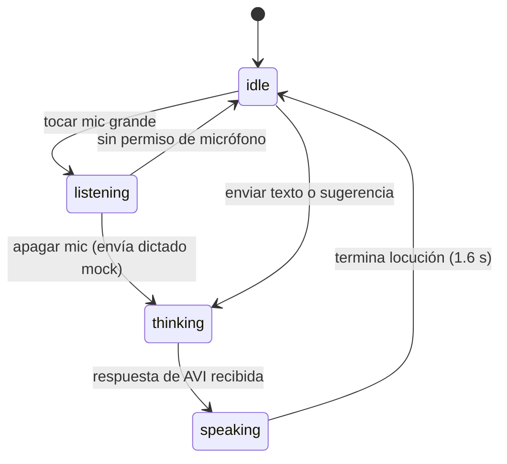

# FLOW — AVI voz-primero

AVI es el protagonista: la vista `chat` es un **escenario** donde la cara mira de
frente y reacciona en vivo al ciclo de voz. La transcripción escrita existe, pero
es secundaria: un panel plegable que se abre solo cuando hace falta.

La navegación vive en un **rail de vidrio** (columna izquierda en desktop, barra
inferior fija en móvil) con tres destinos. No hay rutas anidadas ni sub-flujos:
cada destino es una vista completa del mismo shell.

| id | Vista | Descripción |
|---|---|---|
| `chat` | Escenario + micrófono | AVI de frente: cara, estado, onda de sonido y mic grande; texto como alternativa |
| `history` | Lista de conversaciones | Sesiones pasadas con título y fecha |
| `info` | Niveles de contexto | Qué datos ve AVI según la identidad activa |

## Ciclo de interacción (voz)

El escenario refleja el estado en cuatro canales a la vez: expresión de la cara,
etiqueta de estado, onda de sonido (amplitud/ritmo) y brillo del micrófono.

| id | Estado | Disparador | Cara | Onda | Mic |
|---|---|---|---|---|---|
| `idle` | En línea | reposo | sonrisa, parpadeo | baja y lenta (2.2 s) | vidrio neutro |
| `listening` | Escuchando… | mic encendido | ojos abiertos, cejas arriba | **nivel real del micrófono** | relleno accent + pulso |
| `thinking` | Pensando… | respuesta en vuelo | párpados medios, mirada arriba | media (1.1 s) | vidrio neutro |
| `speaking` | Hablando… | respuesta recibida (1.6 s) | boca que habla | máxima y veloz (0.38 s) | vidrio neutro |

## Micrófono real (permiso)

Encender el mic pide `getUserMedia({ audio })` y queda abierto hasta que el
usuario lo apague (ahí se envía el dictado mock y el ciclo sigue). Con permiso
concedido, un `AnalyserNode` (fft 2048) mide el pico por frame y alimenta un
historial deslizante de 48 barras (~30 fps, ventana de 1.6 s): se ve la forma
del sonido, susurros incluidos (gamma 0.5 + ganancia ×2, escala ×7.5 sobre
barras de 6px). Si el permiso se deniega, la onda vuelve a la simulación por
estado y avisa: *micrófono sin permiso — onda simulada*. Al apagar el mic se
liberan tracks y AudioContext.

## Modo prueba de expresiones

El chip **Probar expresiones** recorre el ciclo `joy → surprise → anger → sad →
listening → thinking → speaking → idle` (1.4 s cada una) y vuelve solo al estado
vivo al terminar; un chip en el escenario permite detenerlo antes. Durante la
prueba la etiqueta de estado se reemplaza por el nombre de la emoción y la cara
toma su color (ver SCREENS).

## Transcripción secundaria

El thread de mensajes no compite con el escenario:

- Sin conversación: no existe; el escenario muestra el saludo (*Hola, soy AVI*).
- Al primer mensaje: se abre automáticamente como panel de vidrio bajo el
  escenario (`max-height: 34%`, scroll propio, `aria-live="polite"`).
- Después: se pliega/despliega con el botón redondo del composer
  (`aria-expanded`), para devolverle el espacio a la cara.

El composer queda siempre al pie como alternativa de texto: input + *Enviar* +
chips de sugerencia por identidad.

## Identidad (select del header)

Cambiar la identidad recarga el contexto visible y las sugerencias; no borra el
thread activo. Es un cambio de alcance, no de vista.
