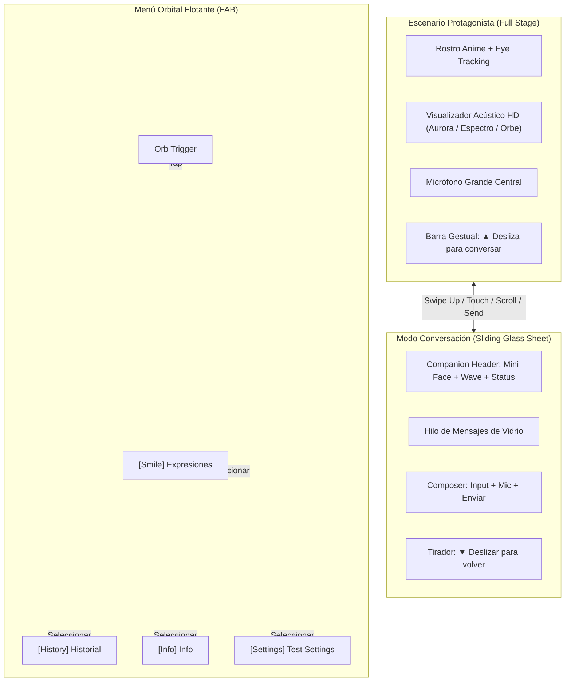
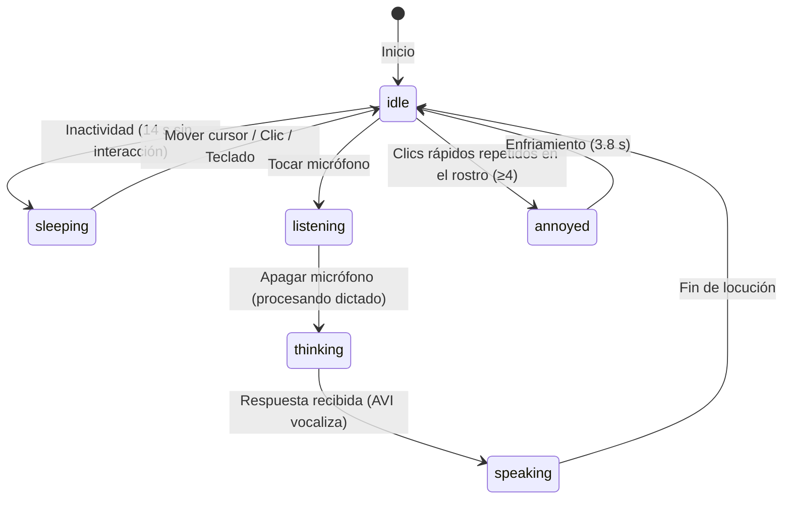

# FLOW — AVI: Asistente de Salud de Próxima Generación

AVI redefine la interacción entre el usuario y un agente de IA de salud:
**Cero barras rígidas (Headerless), escenario inmersivo protagonista y navegación gestual fluida.**

---

## 1. Filosofía de Interacción

1. **Escenario Protagonista (Stage-First):**
   * El rostro anime de AVI y su campo de sonido son el núcleo visual. No hay cabeceras web obsoletas ni barras laterales permanentes que resten inmersión.
   * La mirada de AVI sigue el cursor en tiempo real con perspectiva 3D, respira suavemente y parpadea con naturalidad según las leyes del **comportamiento biológico** (sacadas sacádicas y parpadeo estocástico; ver `docs/BIOLOGICAL_BEHAVIOR.md`).
   * Cuenta con **física de descanso**: tras 14 s de inactividad duerme plácidamente (`sleeping` con Zzz flotantes y burbuja nasal anime). Al mover el cursor o interactuar, despierta.
   * **Mecánica de carisma anime:** si el usuario la toca repetidamente en rápida sucesión, AVI se ruboriza y se molesta temporalmente con un puchero, colmillo *yaeba* y su marca de tensión anime (`💢`).

2. **Transición Gestual a Conversación (Push-Up / Swipe Drawer):**
   * La conversación escrita no compite con el escenario: vive en una sábana (*Sheet*) deslizante de cristal.
   * **Gestos intuitivos:**
     * Deslizar hacia arriba (`Swipe Up`) o hacia la izquierda (`Swipe Left`) en pantalla táctil, o hacer scroll hacia abajo con la rueda del ratón, o tocar la barra gestual `[▲ Ver conversación]` empuja el escenario hacia el **Modo Conversación**.
     * Enviar texto o dictar por voz expande automáticamente la conversación para leer la respuesta.
     * En el Modo Conversación, AVI se transforma elegantemente en un **compañero flotante en cabecera** (*Companion Avatar*), manteniendo su expresividad anime, seguimiento visual y onda viva mientras el hilo de mensajes fluye debajo.
     * Deslizar hacia abajo (`Swipe Down`) o tocar el tirador devuelve la vista al escenario completo con animación elástica de resorte (*spring physics*).

3. **Menú Orbital Flotante (Floating Radial Menu):**
   * Sustituye al antiguo rail lateral por un único botón orbital (**FAB**) en la esquina superior.
   * Al tocarlo, despliega en abanico circular satélites de cristal con iconos luminosos y etiquetas flotantes:
     1. [Radio] **Escenario Protagonista** (retorno al modo principal)
     2. [MessageSquare] **Conversación / Chat** (apertura de la sábana de mensajes)
     3. [Smile] **Catálogo de Expresiones** (explorador interactivo anime)
     4. [History] **Historial de Sesiones** (sesiones anteriores de salud)
     5. [Info] **Contexto & Superficies** (niveles de seguridad y datos PHR)
     6. [Settings] **Ajustes & Simulación (`test_settings`)** (cambio de rol, pantalla completa inmersiva, triggers de avatar)

---

## 2. Diagrama de Navegación

---

## 3. Ciclo de Estados Vocales y Expresivos

| Estado | Gatillador | Expresión Anime | Visualizador Acústico | Comportamiento |
|---|---|---|---|---|
| `idle` | Reposo | Ojos amables, mirada errante, parpadeo | Ondas suaves fluidas | Sigue el puntero del mouse |
| `sleeping` | 14 s inactividad | Ojos cerrados `˘ ˘`, letras `Zzz` flotando | Respiración casi plana | Respiración profunda, no sigue mouse |
| `annoyed` | Toques rápidos (≥4) | Ceño fruncido, ojos afilados, marca `💢`, sacudida | Onda tensa vibrante | Globo de texto cómico de protesta |
| `listening` | Micrófono abierto | Ojos atentos curiosos, boca en "o" pulsante | **FFT de voz en vivo (Canvas 60 FPS)** | Micrófono iluminado en cyan pulsante |
| `thinking` | Procesando consulta | Mirada alzada reflexiva, ceja asimétrica | Pulso rítmico medio | Evaluación de contexto según rol |
| `speaking` | Emitiendo respuesta | Boca anime hablando sincronizada | Modulación dinámica vigorosa | Parpadeo ágil de habla |

---

## 4. Paneles de Hoja Flotante (Floating Modal Sheets)

Los destinos secundarios (`expressions`, `history`, `info`, `settings`) se presentan como hojas flotantes con desenfoque de cristal sobre el escenario, sin reiniciar el estado de la conversación ni desmotar el avatar:
* Al cerrar con `✕` o tocar el fondo, el usuario regresa inmediatamente al punto exacto donde estaba con AVI.

---

## 5. Atajos de Teclado y Control Rápido (PC)

Para usuarios de escritorio y power users, AVI ofrece control por teclado sin fricción:

| Atajo | Acción | Contexto |
|---|---|---|
| `Espacio` o `M` | Alternar dictado / micrófono | Fuera de campos de texto |
| `/` | Abrir conversación y enfocar campo de entrada | Global |
| `T` | Alternar tema (Oscuro Obsidiana ↔ Claro Pastel) | Global |
| `Esc` | Cerrar hoja de chat o paneles modales | Global |

---

## 6. Flujo Adaptativo: Desktop Split View vs. Mobile Sheet

AVI adapta su arquitectura espacial según el tamaño de la pantalla:

1. **Pantallas Móviles (`< 900px`):**
   * **Modo Escenario:** AVI ocupa el centro de la pantalla con pedestal holográfico y barra de telemetría.
   * **Modo Conversación:** Deslizar hacia arriba despliega la sábana de chat a pantalla completa con cabecera de avatar miniatura activa (`Companion Header`) que mantiene la mirada y el estado sincronizados.
2. **Pantallas de Escritorio y Tablets (`≥ 900px`):**
   * **Modo Split Screen Inteligente:** Al pulsar el botón de conversación o presionar `/`, el chat no oculta el avatar. Se despliega como un dock lateral de cristal a la derecha ($480\text{ px}$), mientras AVI y su pedestal holográfico permanecen visibles, activos e interactivos a la izquierda.

---

## 7. Flujo Sensorial: Micro-SFX y Respuesta Háptica

1. **Síntesis Web Audio API (Sin latencia de red):**
   * `poke`: Chirp ascendente-descendente anime al acariciar o pulsar el rostro.
   * `micOn` / `micOff`: Sweeps armónicos que confirman el inicio y detención de la escucha.
   * `reply`: Tríada armónica celestial en $F\# - A\# - C\#$ cuando AVI completa su respuesta.
   * `emotion`: Campanilla cristalina de dos tonos al seleccionar una emoción rápida.
   * `toggle`: Micro-click seco al alternar tema o controles.
2. **Control de Privacidad Sonora:**
   * Botón de silencio discreto (`Volume2` / `VolumeX`) en la barra ambiental para trabajar en entornos silenciosos.
3. **Háptica Móvil:**
   * Micro-pulsos de vibración (`navigator.vibrate`) en dispositivos táctiles compatibles para dar tactilidad física a los botones y caricias.

