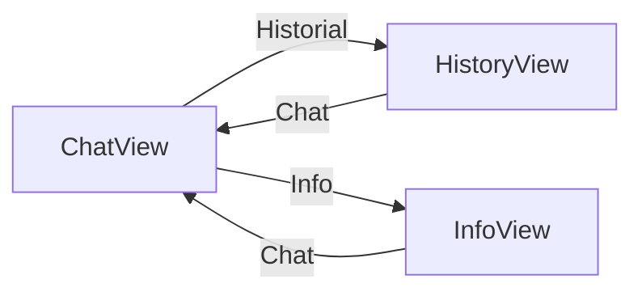

# FLOW — AVI

| id | View | Description |
|---|---|---|
| `chat` | `AviApp` (pestaña `chat`) | Chat conversacional con selector de identidad, chips de sugerencia y compositor (voz + entrada). Incluye el botón de modo inmersivo (fullscreen). |
| `history` | `AviApp` (pestaña `history`) | Lista estática de conversaciones de ejemplo (mock, sin backend). |
| `info` | `AviApp` (pestaña `info`) | Niveles de contexto por identidad (0–3) y superficies de AVI. |

La navegación entre pestañas es local (estado `view`); el modo inmersivo
(`isFullscreen`) no es una vista sino un estado del navegador sobre `chat`.
