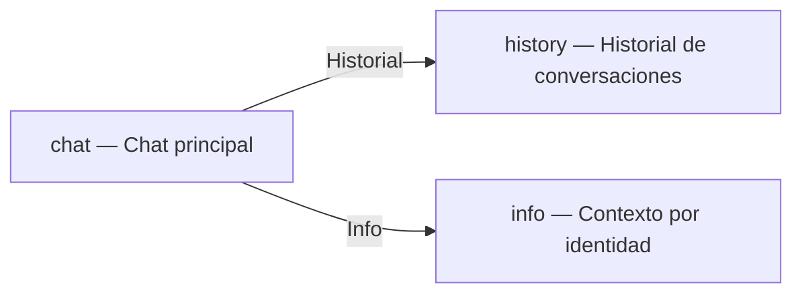

# FLOW — AVI Conversacional

| id | View | Descripción |
|---|---|---|
| `chat` | `AviApp` (vista chat) | Chat principal con AVI — entrada por texto o voz (mock), sugerencias contextuales según rol |
| `history` | `AviApp` (vista historial) | Lista de conversaciones pasadas con fecha y título |
| `info` | `AviApp` (vista info) | Tabla de niveles de contexto según identidad del usuario |

## Pantallas del chat (sub-vistas)

| id | Pantalla | Descripción |
|---|---|---|
| `empty-state` | Sin conversación | Face grande + hint de bienvenida |
| `conversation` | Conversación activa | Face pequeño + thread de mensajes + composer |
| `listening` | Escuchando | Indicador animado "Escuchando…" |
